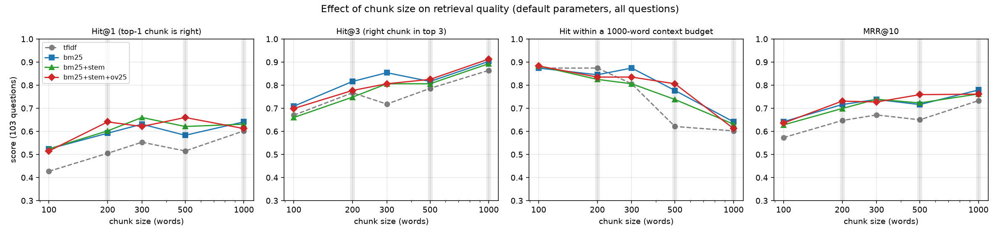

# Document chunking study - how big should a chunk be?

**Question (one sentence):** *When we split the Faculty of Applied Science student handbook into fixed-size word chunks and retrieve with a keyword search, does a chunk size of 200, 500 or 1000 words find the passage that answers a student's question most reliably?*

Everything is reproducible with one command (`python -m src.run_all`, about a minute, CPU only, no internet, no LLM or external API). **All numbers below are generated from `results/*.csv` by `src/make_report.py`.**

## 1. Data
* `data/Hand-Book-Fas-2021-2022.pdf` - FAS, University of Vavuniya handbook (252 pages: regulations, curricula, exam rules, services, detailed syllabi). Public document; no student or staff records.
* Pages 1-8 (cover, preface, contents) are dropped; running headers/page numbers removed; words broken by LaTeX line-hyphenation ("continua- tion") are repaired -> 244 pages, 64,752 words in this run.
* **103 hand-written questions** (`data/questions.json`) in 5 categories (fact 39, rule 28, facility 14, syllabus 12, table 10). Each has 1-2 **gold evidence phrases** copied from the handbook. A chunk is *relevant* if it contains a gold phrase, so the label depends only on the text and every chunk size is judged by the same rule. `python -m src.validate_questions` checks that each phrase exists in the corpus.

## 2. Baseline and methods
| name | what it is |
|---|---|
| `random` | random chunk order (sanity floor, 50 repetitions) |
| **`tfidf` (BASELINE)** | TF-IDF + cosine similarity (scikit-learn), fixed chunks, no overlap |
| `bm25` | Okapi BM25 written from scratch (`src/retrieval.py`) |
| `bm25+stem` | + tiny suffix stemmer (resitting ~ resit, credits ~ credit) |
| `bm25+stem+ov25` | + 25 % overlap between consecutive chunks |

Chunk sizes: **200 / 500 / 1000 words (required)**, plus 100 and 300 as extra points in the CSVs and figure.

## 3. Evaluation protocol
* Metrics: **Hit@1, Hit@3, Hit@5, MRR@10** and **Hit within a 1000-word budget** (top-k with k = ceil(1000 / size): top-5 for 200-word chunks, top-2 for 500, top-1 for 1000). Plain top-k is unfair across sizes because three 1000-word chunks hand the reader 5x more text than three 200-word chunks.
* **Table A** (cleanest chunk-size comparison): default parameters, no tuning, all 103 questions, bootstrap CIs, paired bootstrap for differences.
* **Table B**: stratified 70/30 split -> DEV 72 / **held-out TEST 31**. BM25 `k1, b` chosen by **5-fold CV inside DEV** (select on training folds, score on the held-out fold), refit on DEV, scored once on TEST.
* **Error analysis:** every question whose top-1 chunk is wrong is saved with an automatic tag (`results/error_analysis_*.csv`) and discussed by hand in Section 5.

## 4. Results
**Table A** - all 103 questions, default parameters (`results/table_A_default_all_questions.csv`). Random order at 500 words scores Hit@1 0.010, Hit@3 0.032.

| method | size | Hit@1 | Hit@3 | MRR@10 | Hit @1000-word budget |
|---|---|---|---|---|---|
| tfidf | 200 | 0.505 | 0.767 | 0.647 | 0.874 |
| bm25 | 200 | 0.592 | 0.816 | 0.716 | 0.845 |
| bm25+stem | 200 | 0.602 | 0.748 | 0.699 | 0.825 |
| bm25+stem+ov25 | 200 | 0.641 | 0.777 | 0.731 | 0.835 |
| tfidf | 500 | 0.515 | 0.786 | 0.650 | 0.621 |
| bm25 | 500 | 0.583 | 0.816 | 0.716 | 0.777 |
| bm25+stem | 500 | 0.621 | 0.806 | 0.723 | 0.738 |
| bm25+stem+ov25 | 500 | 0.660 | 0.825 | 0.759 | 0.806 |
| tfidf | 1000 | 0.602 | 0.864 | 0.733 | 0.602 |
| bm25 | 1000 | 0.641 | 0.903 | 0.779 | 0.641 |
| bm25+stem | 1000 | 0.631 | 0.893 | 0.762 | 0.631 |
| bm25+stem+ov25 | 1000 | 0.612 | 0.913 | 0.761 | 0.612 |



**Table B** - `bm25+stem+ov25`, tuned by CV on DEV, one-shot TEST (n = 31) (`results/table_B_tuned_cv_and_test.csv`):

| size | CV MRR (mean +- sd, 5 folds) | TEST MRR | TEST Hit@1 |
|---|---|---|---|
| 200 | 0.722 +- 0.139 | 0.742 | 0.645 |
| 500 | 0.717 +- 0.138 | 0.833 | 0.774 |
| 1000 | 0.724 +- 0.102 | 0.825 | 0.710 |

**What the numbers say**
1. **Baseline vs improvement** (`bm25+stem+ov25` minus TF-IDF, same chunk size, paired bootstrap on MRR@10, `results/paired_bootstrap_vs_baseline.csv`):
   * 100 words: +0.063 MRR, 95 % CI [-0.021, +0.141] - NOT significant (CI contains 0)
   * 200 words: +0.084 MRR, 95 % CI [+0.011, +0.154] - significant
   * 300 words: +0.056 MRR, 95 % CI [-0.014, +0.132] - NOT significant (CI contains 0)
   * 500 words: +0.109 MRR, 95 % CI [+0.046, +0.177] - significant
   * 1000 words: +0.028 MRR, 95 % CI [-0.035, +0.090] - NOT significant (CI contains 0)
2. **The answer to "which chunk size is best" depends on how you count.** For `bm25+stem+ov25`, Hit@3 goes 0.777 -> 0.825 -> 0.913 for 200 -> 500 -> 1000 words (bigger looks better), but Hit within a 1000-word budget goes 0.835 -> 0.806 -> 0.612 (smaller looks better). Large chunks win mostly because they cover more text per rank position, not because they are ranked more precisely. Best Hit@1 for this system is at **500 words** (0.660).
3. **Are the chunk-size differences real?** Paired bootstrap on MRR@10 for `bm25+stem+ov25`: 200 vs 500 +0.028 [-0.018, +0.077] (not significant); 500 vs 1000 +0.002 [-0.032, +0.037] (not significant); 200 vs 1000 +0.031 [-0.024, +0.091] (not significant). For the TF-IDF baseline: 200 vs 1000 +0.086 [+0.023, +0.152]. Intervals that contain 0 mean I cannot claim a winner. TEST has only 31 questions, so its sampling noise is large (about +-0.15).
4. **Question type matters** (Hit@1 of `bm25+stem+ov25`, `results/by_category.csv`):

| category | n questions | Hit@1 @200 | Hit@1 @500 | Hit@1 @1000 |
|---|---|---|---|---|
| facility | 14 | 1.000 | 0.857 | 0.643 |
| fact | 39 | 0.462 | 0.487 | 0.462 |
| rule | 28 | 0.643 | 0.750 | 0.750 |
| syllabus | 12 | 0.917 | 0.917 | 0.833 |
| table | 10 | 0.500 | 0.500 | 0.500 |

   12 questions are answered at rank 1 only by 200-word chunks and 9 only by 1000-word chunks (`results/flips_200_vs_1000.csv`).
5. **Overlap fixes boundary cuts.** Gold phrases that survive intact in at least one chunk without overlap (`bm25+stem`): 99/103 at 100 words, 102/103 at 200, 102/103 at 500, 102/103 at 1000. With 25 % overlap every phrase is intact at every size (`evidence_covered` column in Table A).

**Practical reading (for this handbook, keyword retrieval):** differences between 200, 500 and 1000 words are small for the best system and mostly not statistically reliable; the robust effects are (a) BM25+stem+overlap beats the TF-IDF baseline at small/medium sizes and (b) the direction of the trade-off between top-k recall and context size (point 2). 300-500 words with 25 % overlap is a sensible compromise: good Hit@1 while keeping retrieved context short.

## 5. Error analysis (35 wrong top-1 predictions of 103 for `bm25+stem+ov25` at 500 words)
Full list with the offending text: `results/error_analysis_bm25_stem_500w_ov25.csv` (also 200 and 1000 words). Automatic first-guess tags: competing_chunk 16, vocabulary_gap 10, sibling_clause 9. By category: fact 20, rule 7, table 5, facility 2, syllabus 1.

Hand-read diagnosis of the failures that appear in this run (ranks are from this run):

| qid | question | rank of right chunk | diagnosis |
|---|---|---|---|
| Q025 | When does a degree officially take effect? | 25 | Paraphrase: handbook says *effective date* ... last date of final end-semester exam; question says *officially take effect*. My toy stemmer does not map effect ~ effective. |
| Q003 | What is the best grade I can get if I repeat an exam? | 5 | Synonyms: *repeat* = resit, *best* = highest. |
| Q011 | In which language are the degree programmes taught? | 2 | Wrong sense of *language*: top-1 is the award rule mentioning *English Language I and II*; the handbook phrase is *medium of instruction*. |
| Q012 | When do I have to be at the exam venue before a paper begins? | 2 | Handbook: "attendance outside the examination hall at least 15 minutes before ..."; almost no shared content words. |
| Q038 | Can I retake a missed in-course assessment after the final exam? | 29 | Paraphrase (*retake / missed* vs *resit / unable to sit*); top-1 is a syllabus evaluation table repeating *In-Course Assessments* and *End-Semester Examination*. |
| Q027 | How many lecture hours make one credit in a theory course? | 11 | Generic words (*hours, course, credit*) matched the Health Centre sentence about *office hours*; the right sentence is "15 hours of lectures is considered as one credit". |
| Q028 | How long is a semester for the physical science programmes? | 2 | Generic-word distractor: the paragraph "Opting for Bachelors Degree" is dense in *degree, programme, honours* and outranks the specific sentence. |
| Q029 | How long does the industrial training last for the computer science honours degree? | 2 | Same distractor as Q028 ("Opting for Bachelors Degree" paragraph wins). |
| Q034 | How long is the industrial training in Environmental Science and how many credits is it? | 4 | Same distractor as Q028; the answer sentence is short ("two months full-time considered as one credit") and shares few query words. |
| Q009 | How are practical course units weighted between coursework and the final practical exam? | 9 | Top-1 is the grade-point table (matches *grade, marks, course*); the weighting sentence (40% / 60%) does not use those words. |
| Q008 | What percentage of a theory course mark comes from the end semester exam? | 2 | Partial false negative: top-1 is a course syllabus with the same 30% / 70% split, not the general regulation. |
| Q036 | What are the credit rules for electives in Level 4 Semester I of Environmental Science? | 6 | Table-header words (*Level, Semester, Credits*) in the IT curriculum table outrank the Environmental Science elective rule. |
| Q039 | What O/L results are required for the IT degree? | 2 | Partial false negative: top-1 holds the *Mathematics* line of the same entry-requirement list; the *English* line is in the neighbouring chunk. |
| Q059 | What percentage of industrial training marks is for the written report in Environmental Science? | 6 | Sibling text: top-1 is the Physical Science training split (daily diary 30 / report 40 / presentation 30); the Environmental Science split is in a different table. |
| Q073 | How many credits is English Language I and in which semester is it taught in Environmental Science? | 20 | The answer is a short table row ("English Language I Level 1 Semester I 3"); an award-rule paragraph full of *credits, core, level* wins. |
| Q100 | Where can I get my admission card for exams? | 2 | Related but different rule: top-1 is 4.4 *Record Book as Identity*, which also mentions the Admission Card; the gold sentence is in the services list. |
| Q072 | What marks do I need to get an A+? | 24 | Tokenisation + numbers: grade symbols like "A+" / "A-" reduce to the stop-word *a*; the score range cannot be matched arithmetically. |
| Q070 | What grade do I get if I score 32 marks? | 2 | Numbers: "32 marks" can never lexically match the range "30-34". |
| Q032 | How many weeks long are semesters in the Environmental Science programme? | 3 | Sibling text: Physical Science chapter says "sixteen weeks", Bio-science says "15 weeks"; sentence shape identical, programme name is a weak signal. |
| Q061 | Below which grade in English Language must I resit? | 2 | Same words ("English Language I and II", "grade C") appear in the award-of-degree rules; right vocabulary, wrong section. |
| Q098 | What is the faculty's vision statement? | 2 | Query words *faculty, applied, science* occur everywhere; the plagiarism paragraph repeats them more densely. |
| Q005 | How many years do I have at most to finish the three-year bachelor's degree? | 4 | Topical distractor: class-award paragraphs repeat "within three academic years" and out-score the "maximum duration ... five academic years" sentence. |
| Q006 | What is the time limit for completing an honours degree? | 5 | Same distractor as Q005 ("academic years" in the award-of-class paragraphs). |
| Q026 | How many notional learning hours is one credit? | 9 | Metric false negative: top-1 states the same fact ("One credit shall constitute 50 notional learning hours") in another section. |
| Q055 | How are industrial training marks distributed in the Physical Science department? | 12 | Metric false negative: top-1 (IT industrial-training syllabus) gives the same 30/40/30 split. |
| Q074 | How many theory and practical hours does Applied Hydrology and Water Resource Management have? | 2 | Metric false negative: top-1 is the course's own syllabus page, which states the credits and hours too. |

**Patterns.** (1) *Paraphrase / vocabulary gaps* - the dominant problem for a lexical retriever (resit~retake, medium of instruction~language, effective date~take effect). (2) *Sibling text* - the handbook repeats the same regulation wording for Bio-science and Physical Science programmes and for many course syllabi, so BM25 often returns the right sentence from the wrong programme. (3) *Numbers, tables and tokenisation* - grade symbols such as A+ become stop-words and a mark like 32 cannot match the range 30-34. (4) *Generic-word distractors* - paragraphs dense in common words ("academic years", "credits") outrank the specific sentence. (5) *Metric false negatives* - some wrong top-1 chunks really do contain a correct answer (the same fact is stated elsewhere), so the strict gold-phrase metric slightly under-estimates every system.
**What would fix them:** query expansion or dense embeddings for paraphrases, structure-aware chunks that keep the programme heading with each paragraph, a tokeniser that keeps grade symbols, and a table-aware parser.

## 6. Limitations
* 103 questions written by one person -> wide confidence intervals; TEST has only 31 questions. Chunk-size conclusions are suggestive, not definitive.
* Relevance = "chunk contains a gold phrase"; other chunks may also answer the question. Questions were written after reading the handbook, so they are somewhat vocabulary-aligned; real students would paraphrase more and scores would be lower. (While checking the error file I also found that five grade-table questions only listed one of the handbook's two grade tables as correct; this is fixed in `questions.json`.)
* Retrieval only: no LLM answer generation and no dense embeddings were evaluated (no internet in the build environment). Dense retrieval may shift the best chunk size.
* One document, one language, one retrieval family. Fixed word windows ignore headings and sentence boundaries.
* The stemmer is a 20-line toy, not Porter; the BM25 tuning grid is small (12 settings).
* Extracted text depends slightly on the pypdf version, so exact numbers can differ by a few hundredths between machines.

## 7. Privacy
Only the public handbook is used. Nothing is sent to any external service; all computation is local. Do not add real student or staff records to `data/`.

## 8. Reproduce
```bash
pip install -r requirements.txt     # or: python -m pip install --user -r requirements.txt
python -m src.run_all               # extract -> validate -> experiments -> figures -> error analysis -> this README
python -m src.error_analysis bm25 500 0.25   # error table for any (method, size, overlap)
python -m pytest -q tests           # unit tests (chunking, metrics, retrievers, split)
```
Layout: `src/extract.py` - `chunking.py` - `retrieval.py` (TF-IDF, BM25) - `evaluate.py` - `run_experiments.py` - `error_analysis.py` - `make_figures.py` - `make_report.py`; `data/questions.json`; `results/`. Seed = 42 everywhere.
